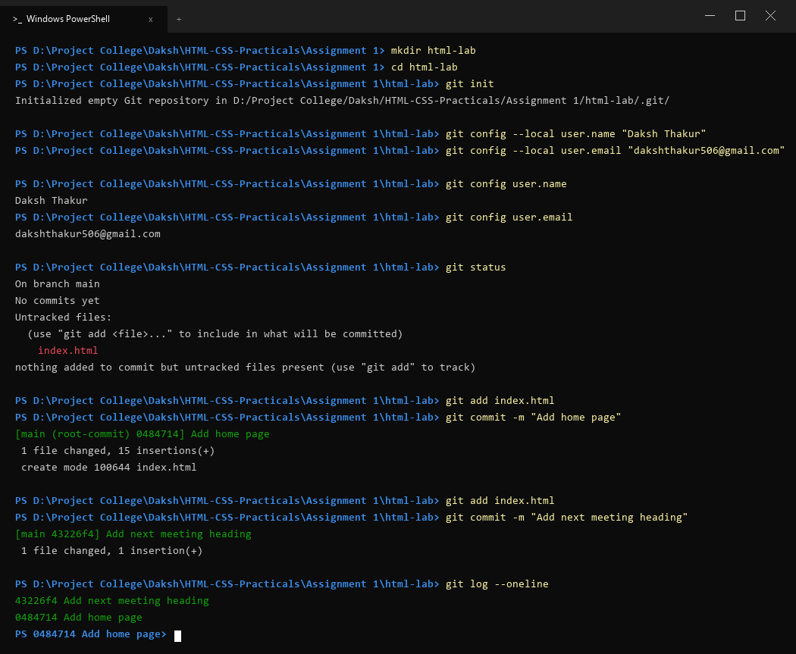

# Assignment 1: Starting a Git Repository

## 1. Aim
Start a Git repository for your lab folder and save your work with commits.

---

## 2. Theoretical Background
Git is a free and open-source distributed version control system designed to handle everything from small to very large projects with speed and efficiency.

- Repository (.git folder): A hidden database that tracks all changes, branches, tags, and commits.
- Working Tree: The directory of files currently visible on the file system.
- Staging Area (Index): A middle ground where changes are formatted and reviewed before committing.
- Commit: An immutable snapshot of the staging area preserved with a unique 40-character SHA-1 hash, author metadata, timestamp, and log message.
- Local vs Global Configuration: git config --local scopes settings solely to the current repository, overriding global machine settings (--global).

---

## 3. Tasks and Procedure

### Task 1: Initialize Repository and Configure Local Identity
1. Create a directory named html-lab and change directory into it.
2. Initialize an empty Git repository using git init.
3. Configure local repository identity using:
   - git config --local user.name "Daksh Thakur"
   - git config --local user.email "dakshthakur506@gmail.com"
4. Verify the configurations using git config user.name and git config user.email.

### Task 2: Create First File, Inspect Status and Commit
1. Create index.html with an h1 heading.
2. Verify untracked status with git status.
3. Stage index.html using git add index.html.
4. Create the initial commit with the exact message: "Add home page".

### Task 3: Modify File, Second Commit and Inspect Commit Log
1. Add an h2 heading below h1 in index.html.
2. Stage and commit the change with message: "Add next meeting heading".
3. Inspect commit history with git log --oneline.

---

## 4. Source Code (index.html)

```html
<!DOCTYPE html>
<html lang="en">
<head>
    <meta charset="UTF-8">
    <title>Assignment 1 - Welcome to HTML Lab | Daksh Thakur</title>
</head>
<body>
    <h1>Welcome to My HTML Lab - Daksh Thakur</h1>
    <h2>Upcoming Lab Meetings and Schedule</h2>
</body>
</html>
```

---

body {
    font-family: Arial, sans-serif;
    margin: 30px;
    background-color: #f8fafc;
    color: #1e293b;
    line-height: 1.6;
}

h1 {
    color: #0f172a;
    border-bottom: 2px solid #e2e8f0;
    padding-bottom: 10px;
}

h2 {
    color: #334155;
    margin-top: 20px;
}
```

---

## 5. Terminal Output Verification

```powershell
PS D:\Project College\Daksh\HTML-CSS-Practicals\Assignment 1> mkdir html-lab
PS D:\Project College\Daksh\HTML-CSS-Practicals\Assignment 1> cd html-lab
PS D:\Project College\Daksh\HTML-CSS-Practicals\Assignment 1\html-lab> git init
Initialized empty Git repository in D:/Project College/Abhinav/HTML-CSS-Practicals/Assignment 1/html-lab/.git/

PS D:\Project College\Daksh\HTML-CSS-Practicals\Assignment 1\html-lab> git config --local user.name "Daksh Thakur"
PS D:\Project College\Daksh\HTML-CSS-Practicals\Assignment 1\html-lab> git config --local user.email "dakshthakur506@gmail.com"

PS D:\Project College\Daksh\HTML-CSS-Practicals\Assignment 1\html-lab> git config user.name
Daksh Thakur

PS D:\Project College\Daksh\HTML-CSS-Practicals\Assignment 1\html-lab> git config user.email
dakshthakur506@gmail.com

PS D:\Project College\Daksh\HTML-CSS-Practicals\Assignment 1\html-lab> git status
On branch main
No commits yet
Untracked files:
  (use "git add <file>..." to include in what will be committed)
	index.html
nothing added to commit but untracked files present (use "git add" to track)

PS D:\Project College\Daksh\HTML-CSS-Practicals\Assignment 1\html-lab> git add index.html
PS D:\Project College\Daksh\HTML-CSS-Practicals\Assignment 1\html-lab> git commit -m "Add home page"
[main (root-commit) 6b50164] Add home page
 1 file changed, 14 insertions(+)
 create mode 100644 index.html

PS D:\Project College\Daksh\HTML-CSS-Practicals\Assignment 1\html-lab> git add index.html
PS D:\Project College\Daksh\HTML-CSS-Practicals\Assignment 1\html-lab> git commit -m "Add next meeting heading"
[main e70faa2] Add next meeting heading
 1 file changed, 1 insertion(+)

PS D:\Project College\Daksh\HTML-CSS-Practicals\Assignment 1\html-lab> git log --oneline
e70faa2 Add next meeting heading
6b50164 Add home page
```

---

## 6. Output Screenshot

The terminal execution and local git commits are verified below:



---

## 7. Conclusion
In this practical, a local Git repository was successfully initialized inside html-lab. The local user configuration parameters (user.name and user.email) were assigned and verified. Changes to index.html were staged and committed over sequential revisions, and verified using git log --oneline.
