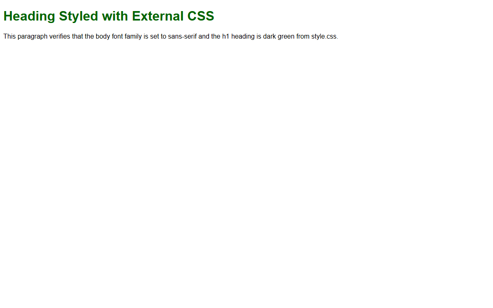

# Assignment 10 - CSS Fundamentals

## 1. Aim
Write styles inline, in a style block in the head, and in an external stylesheet.

## 2. Theoretical Background
- **Three Ways to Apply CSS**:
  - **Inline Styles**: Defined directly within an element's `style` attribute (highest specificity).
  - **Internal Stylesheet**: Defined within a `<style>` block in the document's `<head>`.
  - **External Stylesheet**: Defined in a separate `.css` file and linked via `<link rel="stylesheet">`.
- **CSS Selectors**:
  - Element (Type) selector: Targets tags directly (`body`, `h1`, `p`).

## 3. Tasks Breakdown
- **Task 1 (`inline-internal.html`)**: Two paragraphs. First paragraph styled red via inline style; second paragraph styled blue via internal style sheet in the `<head>`.
- **Task 2 (`style.css`)**: External stylesheet setting `body` font family to `sans-serif` and `h1` color to `darkgreen`.
- **Task 3 (`linked.html`)**: HTML page linking to `style.css` with an `h1` heading and a paragraph to verify both rules take effect.

## 4. Code Listings

### inline-internal.html:
```html
<!DOCTYPE html>
<html lang="en">
<head>
    <meta charset="UTF-8">
    <title>Inline and Internal CSS</title>
    <style>
        .blue-text {
            color: blue;
        }
    </style>
</head>
<body>
    <p style="color: red;">This is the first paragraph styled with red text using an inline style.</p>
    <p class="blue-text">This is the second paragraph styled with blue text using an internal style sheet in the head.</p>
</body>
</html>
```

### style.css:
```css
body {
    font-family: sans-serif;
}

h1 {
    color: darkgreen;
}
```

### linked.html:
```html
<!DOCTYPE html>
<html lang="en">
<head>
    <meta charset="UTF-8">
    <title>Linked External Stylesheet</title>
    <link rel="stylesheet" href="style.css">
</head>
<body>
    <h1>Heading Styled with External CSS</h1>
    <p>This paragraph verifies that the body font family is set to sans-serif and the h1 heading is dark green from style.css.</p>
</body>
</html>
```

## 5. Output Verification
Browser output for linked external stylesheet (`linked.html`):



## 6. Conclusion
Demonstrated inline styling, internal stylesheet blocks, and external stylesheets linking rules cleanly to HTML elements.
