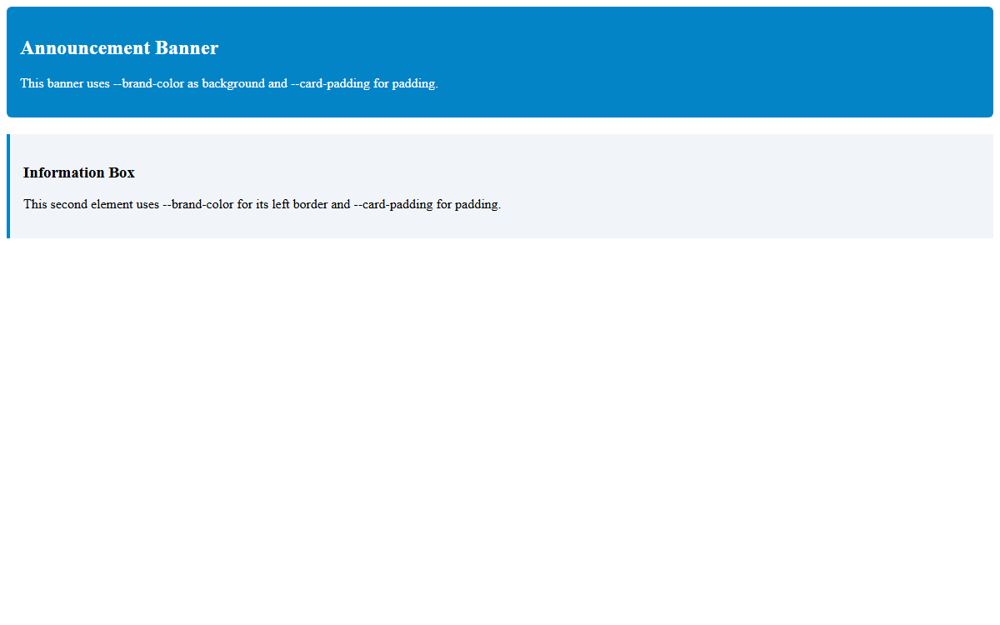

# Assignment 11 - Units and CSS Variables

## 1. Aim
Compare px and %, use rem for text, and share colors with CSS variables.

## 2. Theoretical Background
- **Absolute vs Relative Units**:
  - `px`: Fixed pixel size regardless of parent or viewport.
  - `%`: Relative percentage based on the parent container's dimensions.
  - `rem`: Relative unit based on the root (`<html>`) font size.
- **CSS Custom Properties (Variables)**:
  - Declared on `:root` using `--variable-name: value;`.
  - Accessed across selectors using `var(--variable-name)`.

## 3. Tasks Breakdown
- **Task 1 (`units.html`)**: Two div boxes: one with `width: 300px` and one with `width: 50%`. Inside each, a paragraph with `font-size: 1.2rem`.
- **Task 2 (`variables.html`)**: Defined `--brand-color` (blue) and `--card-padding: 16px` on `:root` and applied them to a card div.
- **Task 3 (`tokens.css` & `tokens.html`)**: Reusable external `tokens.css` with the two variables, linked and used across two different elements.

## 4. Code Listings

### units.html:
```html
<!DOCTYPE html>
<html lang="en">
<head>
    <meta charset="UTF-8">
    <title>CSS Units: px, %, and rem</title>
    <style>
        .box-fixed {
            width: 300px;
            background-color: #e0f2fe;
            border: 1px solid #0284c7;
            padding: 10px;
            margin-bottom: 15px;
        }
        .box-fluid {
            width: 50%;
            background-color: #f0fdf4;
            border: 1px solid #16a34a;
            padding: 10px;
        }
        .box-fixed p, .box-fluid p {
            font-size: 1.2rem;
            margin: 0;
        }
    </style>
</head>
<body>
    <div class="box-fixed">
        <p>Fixed width box (300px) with 1.2rem text.</p>
    </div>
    <div class="box-fluid">
        <p>Fluid width box (50%) with 1.2rem text.</p>
    </div>
</body>
</html>
```

### variables.html:
```html
<!DOCTYPE html>
<html lang="en">
<head>
    <meta charset="UTF-8">
    <title>CSS Custom Properties (Variables)</title>
    <style>
        :root {
            --brand-color: #0284c7;
            --card-padding: 16px;
        }
        .card {
            border: 2px solid var(--brand-color);
            color: var(--brand-color);
            padding: var(--card-padding);
            border-radius: 8px;
            max-width: 400px;
            background-color: #f8fafc;
        }
        .card h2 {
            margin-top: 0;
        }
    </style>
</head>
<body>
    <div class="card">
        <h2>Card with CSS Variables</h2>
        <p>This card uses --brand-color for its border and text, and --card-padding for 16px internal spacing.</p>
    </div>
</body>
</html>
```

### tokens.css:
```css
:root {
    --brand-color: #0284c7;
    --card-padding: 16px;
}
```

### tokens.html:
```html
<!DOCTYPE html>
<html lang="en">
<head>
    <meta charset="UTF-8">
    <title>Tokens Shared Stylesheet Demo</title>
    <link rel="stylesheet" href="tokens.css">
    <style>
        .banner {
            background-color: var(--brand-color);
            color: #ffffff;
            padding: var(--card-padding);
            border-radius: 6px;
            margin-bottom: 20px;
        }
        .info-box {
            border-left: 4px solid var(--brand-color);
            padding: var(--card-padding);
            background-color: #f1f5f9;
        }
    </style>
</head>
<body>
    <div class="banner">
        <h2>Announcement Banner</h2>
        <p>This banner uses --brand-color as background and --card-padding for padding.</p>
    </div>

    <div class="info-box">
        <h3>Information Box</h3>
        <p>This second element uses --brand-color for its left border and --card-padding for padding.</p>
    </div>
</body>
</html>
```

## 5. Output Verification
Browser output for shared tokens (`tokens.html`):



## 6. Conclusion
Fixed pixels, responsive percentages, scalable rem typography, and CSS custom properties were successfully demonstrated.
