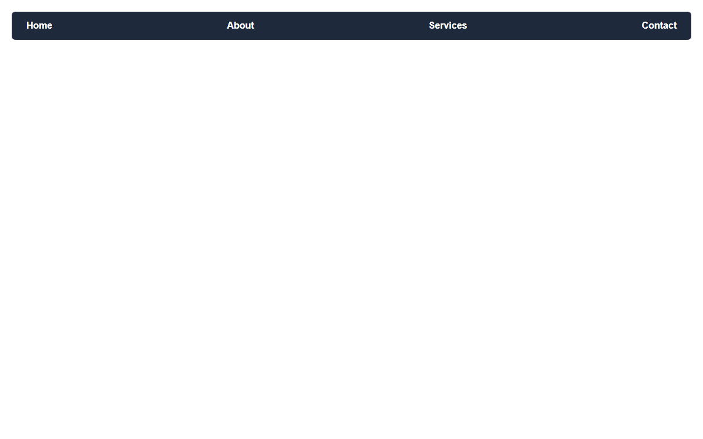

# Assignment 13 - Flexbox Layouts

## 1. Aim
Build a navigation bar, centre a card, and make a row of cards that wrap.

## 2. Theoretical Background
- **Flexbox (`display: flex`)**: One-dimensional layout module for distributing space and aligning items.
  - `justify-content`: Aligns items along the main axis (`space-between`, `center`).
  - `align-items`: Aligns items along the cross axis (`center`).
  - `flex-wrap: wrap`: Allows flex items to break into multiple rows when available space is filled.

## 3. Tasks Breakdown
- **Task 1 (`nav-flex.html`)**: Navigation bar with four links using `display: flex` and `justify-content: space-between` to space items across the page.
- **Task 2 (`centred-cards.html`)**: Container with one card div placed in the exact centre of the window using `justify-content: center` and `align-items: center`.
- **Task 3 (`wrapping-cards.html`)**: Container with six small card divs (150px wide) that wrap into multiple rows as the screen resizes.

## 4. Code Listings

### nav-flex.html:
```html
<!DOCTYPE html>
<html lang="en">
<head>
    <meta charset="UTF-8">
    <title>Flexbox Navigation Bar</title>
    <style>
        body {
            margin: 0;
            font-family: Arial, sans-serif;
            padding: 20px;
        }
        nav {
            display: flex;
            justify-content: space-between;
            background-color: #1e293b;
            padding: 15px 25px;
            border-radius: 6px;
        }
        nav a {
            color: #ffffff;
            text-decoration: none;
            font-weight: bold;
        }
        nav a:hover {
            color: #38bdf8;
        }
    </style>
</head>
<body>
    <nav>
        <a href="#home">Home</a>
        <a href="#about">About</a>
        <a href="#services">Services</a>
        <a href="#contact">Contact</a>
    </nav>
</body>
</html>
```

### centred-cards.html:
```html
<!DOCTYPE html>
<html lang="en">
<head>
    <meta charset="UTF-8">
    <title>Centred Card with Flexbox</title>
    <style>
        body {
            margin: 0;
            font-family: Arial, sans-serif;
            background-color: #f1f5f9;
        }
        .container {
            display: flex;
            justify-content: center;
            align-items: center;
            min-height: 100vh;
        }
        .card {
            background-color: #ffffff;
            border: 1px solid #cbd5e1;
            border-radius: 10px;
            padding: 30px;
            box-shadow: 0 10px 15px -3px rgba(0, 0, 0, 0.1);
            text-align: center;
            max-width: 320px;
        }
        .card h2 {
            margin-top: 0;
            color: #0f172a;
        }
        .card p {
            color: #475569;
            margin-bottom: 0;
        }
    </style>
</head>
<body>
    <div class="container">
        <div class="card">
            <h2>Centred Card</h2>
            <p>This card is placed precisely in the centre of the window both horizontally and vertically using Flexbox.</p>
        </div>
    </div>
</body>
</html>
```

### wrapping-cards.html:
```html
<!DOCTYPE html>
<html lang="en">
<head>
    <meta charset="UTF-8">
    <title>Wrapping Cards with Flexbox</title>
    <style>
        body {
            font-family: Arial, sans-serif;
            padding: 20px;
            background-color: #f8fafc;
        }
        .container {
            display: flex;
            flex-wrap: wrap;
            gap: 15px;
        }
        .card {
            width: 150px;
            background-color: #ffffff;
            border: 1px solid #cbd5e1;
            border-radius: 6px;
            padding: 15px;
            text-align: center;
            box-sizing: border-box;
            box-shadow: 0 2px 4px rgba(0, 0, 0, 0.05);
        }
        .card h3 {
            margin-top: 0;
            color: #1e293b;
        }
        .card p {
            margin-bottom: 0;
            color: #64748b;
        }
    </style>
</head>
<body>
    <h1>Responsive Product Catalog</h1>
    <div class="container">
        <div class="card">
            <h3>Card 1</h3>
            <p>Width: 150px</p>
        </div>
        <div class="card">
            <h3>Card 2</h3>
            <p>Width: 150px</p>
        </div>
        <div class="card">
            <h3>Card 3</h3>
            <p>Width: 150px</p>
        </div>
        <div class="card">
            <h3>Card 4</h3>
            <p>Width: 150px</p>
        </div>
        <div class="card">
            <h3>Card 5</h3>
            <p>Width: 150px</p>
        </div>
        <div class="card">
            <h3>Card 6</h3>
            <p>Width: 150px</p>
        </div>
    </div>
</body>
</html>
```

## 5. Output Verification
Flexbox navigation bar output in browser (`nav-flex.html`):



## 6. Conclusion
Mastered flex navigation bar distribution, two-axis centering, and multi-row flex-wrapping cards.
