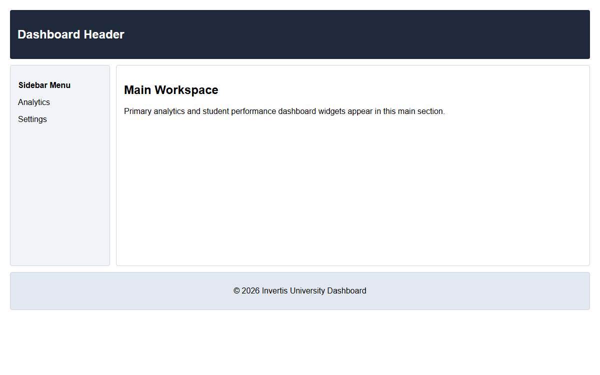

# Assignment 14 - CSS Grid Layouts

## 1. Aim
Build a multi-column grid, an adaptive gallery, and a full-page grid layout.

## 2. Theoretical Background
- **CSS Grid (`display: grid`)**: Two-dimensional layout system managing both columns and rows.
  - `repeat(3, 1fr)`: Generates three equal fractional tracks.
  - `repeat(auto-fill, minmax(120px, 1fr))`: Responsive column creation based on available viewport width.
  - `grid-template-areas`: Visual layout system mapping semantic page regions (header, sidebar, main, footer).

## 3. Tasks Breakdown
- **Task 1 (`grid-first.html`)**: Six items in three equal columns using `repeat(3, 1fr)` with a 12px gap.
- **Task 2 (`gallery.html`)**: Eight items using `repeat(auto-fill, minmax(120px, 1fr))` adapting dynamically to screen size.
- **Task 3 (`dashboard-areas.html`)**: Four child elements arranged into a two-column dashboard using `grid-template-areas`.

## 4. Code Listings

### grid-first.html:
```html
<!DOCTYPE html>
<html lang="en">
<head>
    <meta charset="UTF-8">
    <title>CSS Grid First: Three Equal Columns</title>
    <style>
        body {
            font-family: Arial, sans-serif;
            padding: 20px;
        }
        .container {
            display: grid;
            grid-template-columns: repeat(3, 1fr);
            gap: 12px;
        }
        .item {
            background-color: #e0f2fe;
            border: 1px solid #0284c7;
            padding: 25px;
            text-align: center;
            font-weight: bold;
            font-size: 1.1rem;
            border-radius: 4px;
        }
    </style>
</head>
<body>
    <h1>Three Equal Columns Grid</h1>
    <div class="container">
        <div class="item">Item 1</div>
        <div class="item">Item 2</div>
        <div class="item">Item 3</div>
        <div class="item">Item 4</div>
        <div class="item">Item 5</div>
        <div class="item">Item 6</div>
    </div>
</body>
</html>
```

### gallery.html:
```html
<!DOCTYPE html>
<html lang="en">
<head>
    <meta charset="UTF-8">
    <title>Adaptive Photo Gallery</title>
    <style>
        body {
            font-family: Arial, sans-serif;
            padding: 20px;
        }
        .gallery {
            display: grid;
            grid-template-columns: repeat(auto-fill, minmax(120px, 1fr));
            gap: 12px;
        }
        .item {
            background-color: #fef08a;
            border: 1px solid #ca8a04;
            padding: 30px 10px;
            text-align: center;
            font-weight: bold;
            border-radius: 6px;
        }
    </style>
</head>
<body>
    <h1>Adaptive Photo Gallery</h1>
    <div class="gallery">
        <div class="item">Photo 1</div>
        <div class="item">Photo 2</div>
        <div class="item">Photo 3</div>
        <div class="item">Photo 4</div>
        <div class="item">Photo 5</div>
        <div class="item">Photo 6</div>
        <div class="item">Photo 7</div>
        <div class="item">Photo 8</div>
    </div>
</body>
</html>
```

### dashboard-areas.html:
```html
<!DOCTYPE html>
<html lang="en">
<head>
    <meta charset="UTF-8">
    <title>Dashboard Areas Layout</title>
    <style>
        body {
            margin: 0;
            font-family: Arial, sans-serif;
            padding: 20px;
        }
        .container {
            display: grid;
            grid-template-columns: 200px 1fr;
            grid-template-rows: auto 1fr auto;
            grid-template-areas:
                "header  header"
                "sidebar main"
                "footer  footer";
            gap: 12px;
            min-height: 80vh;
        }
        .header {
            grid-area: header;
            background-color: #1e293b;
            color: #ffffff;
            padding: 15px;
            border-radius: 4px;
        }
        .sidebar {
            grid-area: sidebar;
            background-color: #f1f5f9;
            border: 1px solid #cbd5e1;
            padding: 15px;
            border-radius: 4px;
        }
        .main {
            grid-area: main;
            background-color: #ffffff;
            border: 1px solid #cbd5e1;
            padding: 15px;
            border-radius: 4px;
        }
        .footer {
            grid-area: footer;
            background-color: #e2e8f0;
            border: 1px solid #cbd5e1;
            padding: 12px;
            text-align: center;
            border-radius: 4px;
        }
    </style>
</head>
<body>
    <div class="container">
        <header class="header">
            <h2>Dashboard Header</h2>
        </header>
        <aside class="sidebar">
            <p><strong>Sidebar Menu</strong></p>
            <p>Analytics</p>
            <p>Settings</p>
        </aside>
        <main class="main">
            <h2>Main Workspace</h2>
            <p>Primary analytics and student performance dashboard widgets appear in this main section.</p>
        </main>
        <footer class="footer">
            <p>&copy; 2026 Invertis University Dashboard</p>
        </footer>
    </div>
</body>
</html>
```

## 5. Output Verification
Dashboard areas layout output in browser (`dashboard-areas.html`):



## 6. Conclusion
Grid fractional columns, adaptive auto-fill galleries, and semantic dashboard layout areas were implemented.
