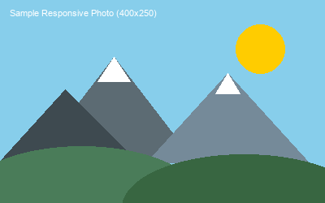
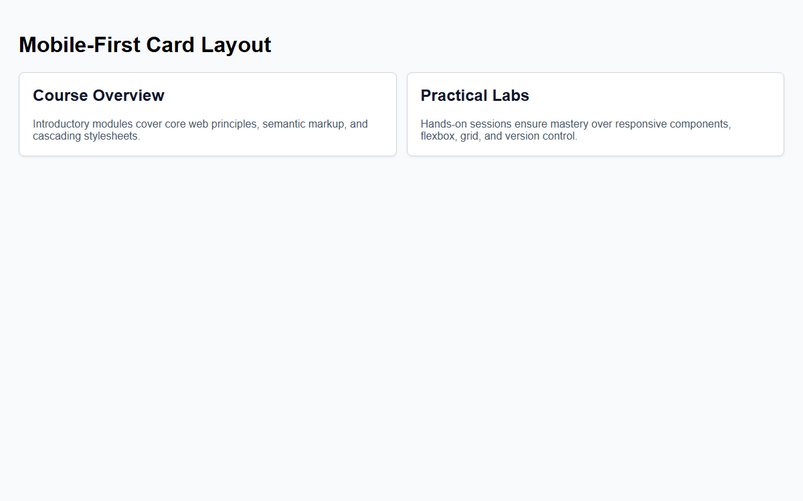

# Assignment 15 - Responsive Pages with Media Queries

## 1. Aim
Use a viewport meta tag, write a mobile-first rule, scale text with rem, and make an image fluid.

## 2. Theoretical Background
- **Viewport Meta Tag**: Configures width and scaling for mobile browsers (`width=device-width, initial-scale=1.0`).
- **Mobile-First Design**: Styling the default layout for smaller viewports and enhancing for desktop via `@media (min-width: ...)`.
- **Responsive Typography**: Scaling the root `font-size` with media queries so all `rem` values adapt smoothly.
- **Fluid Images**: Applying `max-width: 100%` and `height: auto` so images never overflow their parent container.

## 3. Tasks Breakdown
- **Task 1 (`mobile-first.html`)**: Single-column card layout by default, switching to two columns at `@media (min-width: 600px)`.
- **Task 2 (`responsive-text.html`)**: Typography using `rem` units with a `@media (min-width: 768px)` rule increasing root font-size.
- **Task 3 (`responsive-image.html`)**: Image styled with `max-width: 100%` and `height: auto` inside a container.

## 4. Code Listings

### mobile-first.html:
```html
<!DOCTYPE html>
<html lang="en">
<head>
    <meta charset="UTF-8">
    <meta name="viewport" content="width=device-width, initial-scale=1.0">
    <title>Mobile First Responsive Cards</title>
    <style>
        body {
            font-family: Arial, sans-serif;
            padding: 20px;
            background-color: #f8fafc;
        }
        .cards-container {
            display: flex;
            flex-direction: column;
            gap: 15px;
        }
        .card {
            background-color: #ffffff;
            border: 1px solid #cbd5e1;
            border-radius: 8px;
            padding: 20px;
            box-shadow: 0 2px 4px rgba(0, 0, 0, 0.05);
        }
        .card h2 {
            margin-top: 0;
            color: #0f172a;
        }
        .card p {
            color: #475569;
            margin-bottom: 0;
        }
        @media (min-width: 600px) {
            .cards-container {
                flex-direction: row;
            }
            .card {
                flex: 1;
            }
        }
    </style>
</head>
<body>
    <h1>Mobile-First Card Layout</h1>
    <div class="cards-container">
        <div class="card">
            <h2>Course Overview</h2>
            <p>Introductory modules cover core web principles, semantic markup, and cascading stylesheets.</p>
        </div>
        <div class="card">
            <h2>Practical Labs</h2>
            <p>Hands-on sessions ensure mastery over responsive components, flexbox, grid, and version control.</p>
        </div>
    </div>
</body>
</html>
```

### responsive-text.html:
```html
<!DOCTYPE html>
<html lang="en">
<head>
    <meta charset="UTF-8">
    <meta name="viewport" content="width=device-width, initial-scale=1.0">
    <title>Responsive Typography with rem</title>
    <style>
        html {
            font-size: 16px;
        }
        body {
            font-family: Arial, sans-serif;
            padding: 20px;
            line-height: 1.6;
        }
        h1 {
            font-size: 2rem;
            color: #1e293b;
        }
        h2 {
            font-size: 1.5rem;
            color: #334155;
        }
        p {
            font-size: 1rem;
            color: #475569;
        }
        @media (min-width: 768px) {
            html {
                font-size: 20px;
            }
        }
    </style>
</head>
<body>
    <h1>Responsive Scalable Heading</h1>
    <h2>Subheading Scaled by rem Units</h2>
    <p>All typography in this document is specified using rem units based on the root font size. When the screen width exceeds 768px, the media query raises root font size to 20px, scaling all headings and body copy proportionally.</p>
</body>
</html>
```

### responsive-image.html:
```html
<!DOCTYPE html>
<html lang="en">
<head>
    <meta charset="UTF-8">
    <meta name="viewport" content="width=device-width, initial-scale=1.0">
    <title>Fluid Responsive Image</title>
    <style>
        body {
            font-family: Arial, sans-serif;
            padding: 20px;
        }
        .image-container {
            width: 80%;
            max-width: 600px;
            margin: 0 auto;
            border: 2px dashed #94a3b8;
            padding: 10px;
            text-align: center;
        }
        .image-container img {
            max-width: 100%;
            height: auto;
            display: block;
            margin: 0 auto;
        }
    </style>
</head>
<body>
    <h1>Fluid Responsive Image</h1>
    <div class="image-container">
        
    </div>
</body>
</html>
```

## 5. Output Verification
Mobile-first cards rendered in browser (`mobile-first.html`):



## 6. Conclusion
The viewport meta tag was integrated, mobile-first card layouts switching at 600px were built, root-level responsive rem typography was verified, and fluid image scaling was demonstrated.
