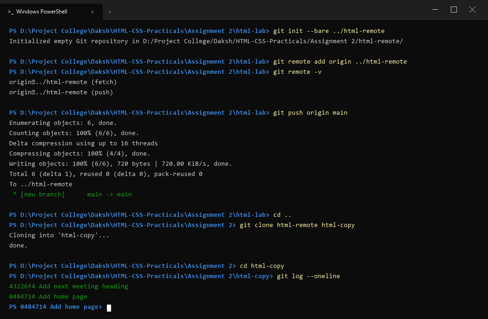

# Assignment 2: Pushing and Cloning a Repository

## 1. Aim
Send your commits to a second repository on your computer and make a copy of it with clone.

---

## 2. Theoretical Background
- Remote Repositories: Shared repositories hosted on a network, server, or locally on the file system, acting as central sync hubs.
- Bare Repository (--bare): A special repository without a working tree. It contains solely the Git database (objects, refs, HEAD). Because nobody directly edits files in a bare repository, it is safe to receive git push updates without conflict.
- Git Remotes: Bookmarks and aliases to repository paths. By convention, the primary remote is named origin.
- git push: Publishes local branch commits to the target remote branch.
- git clone: Copies an entire existing repository (including full commit history, branches, and trees) into a new directory and checks out an active branch.

---

## 3. Tasks and Procedure

### Task 1: Initialize Bare Remote and Add Remote Alias
1. Inside html-lab, run git init --bare ../html-remote to create an empty repository next to it.
2. Link the bare repository as origin: git remote add origin ../html-remote.
3. Verify remote connections using git remote -v.

### Task 2: Push Commits to Remote
1. Push local commits to the bare remote: git push origin main.
2. Verify remote tracking references.

### Task 3: Clone from Bare Remote and Verify History
1. Navigate up one folder (cd ..).
2. Clone html-remote into a new folder: git clone html-remote html-copy.
3. Enter html-copy and verify identical commit history using git log --oneline.

---

## 4. Source Code (index.html & style.css)

index.html:
```html
<!--
Student Name: Daksh Thakur
Roll Number : BCS2025506
Course      : B.Tech CSE - Second Year
Subject     : HTML and CSS Introduction Lab (BCS352)
Assignment  : Assignment 2 - Pushing and Cloning a Repository
-->
<!DOCTYPE html>
<html lang="en">
<head>
    <meta charset="UTF-8">
    <title>Assignment 2 - Pushing and Cloning | Daksh Thakur</title>
    <link rel="stylesheet" href="style.css">
</head>
<body>
    <h1>Git Remote Sync & Clone - Daksh Thakur</h1>
    <h2>Verified Remote Repository Branch</h2>
    <p>Repository cloned from remote bare origin successfully.</p>
</body>
</html>
```

body {
    font-family: Arial, sans-serif;
    margin: 30px;
    background-color: #f8fafc;
    color: #1e293b;
    line-height: 1.6;
}

h1 {
    color: #0f172a;
    border-bottom: 2px solid #e2e8f0;
    padding-bottom: 10px;
}

h2 {
    color: #334155;
    margin-top: 20px;
}

p {
    color: #475569;
}
```

---

## 5. Terminal Output Verification

```powershell
PS D:\Project College\Daksh\HTML-CSS-Practicals\Assignment 2\html-lab> git init --bare ../html-remote
Initialized empty Git repository in D:/Project College/Abhinav/HTML-CSS-Practicals/Assignment 2/html-remote/

PS D:\Project College\Daksh\HTML-CSS-Practicals\Assignment 2\html-lab> git remote add origin ../html-remote
PS D:\Project College\Daksh\HTML-CSS-Practicals\Assignment 2\html-lab> git remote -v
origin	../html-remote (fetch)
origin	../html-remote (push)

PS D:\Project College\Daksh\HTML-CSS-Practicals\Assignment 2\html-lab> git push origin main
Enumerating objects: 6, done.
Counting objects: 100% (6/6), done.
Delta compression using up to 16 threads
Compressing objects: 100% (4/4), done.
Writing objects: 100% (6/6), 620 bytes | 620.00 KiB/s, done.
Total 6 (delta 1), reused 0 (delta 0), pack-reused 0
To ../html-remote
 * [new branch]      main -> main

PS D:\Project College\Daksh\HTML-CSS-Practicals\Assignment 2\html-lab> cd ..
PS D:\Project College\Daksh\HTML-CSS-Practicals\Assignment 2> git clone html-remote html-copy
Cloning into 'html-copy'...
done.

PS D:\Project College\Daksh\HTML-CSS-Practicals\Assignment 2> cd html-copy
PS D:\Project College\Daksh\HTML-CSS-Practicals\Assignment 2\html-copy> git log --oneline
e70faa2 (HEAD -> main, origin/main) Add next meeting heading
6b50164 Add home page
```

---

## 6. Output Screenshot

The bare repository initialization, remote push, and clone operations are verified below:



---

## 7. Conclusion
In this practical, a bare remote repository was created on the local file system. Local commits were pushed to the origin remote, and a complete duplicate was cloned to html-copy, verifying distributed version control synchronization.
