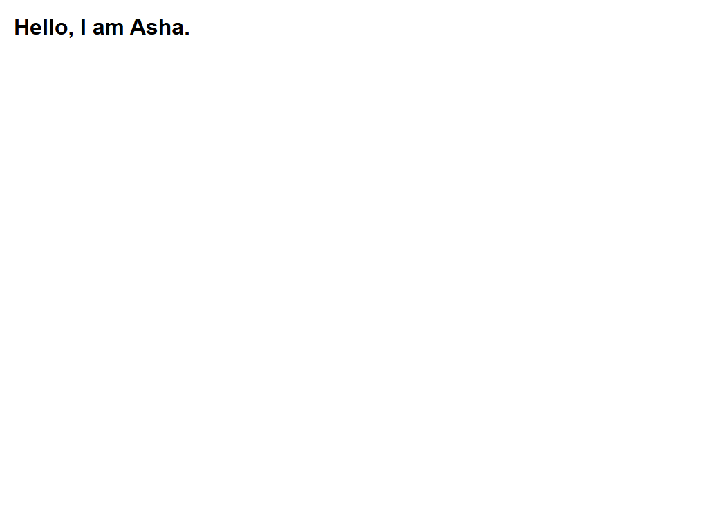

# Assignment 3 - Your First HTML Page

## 1. Aim
Write a first HTML page with a title, headings and a paragraph, and format some text.

## 2. Theoretical Background
- HTML Document Skeleton: Every HTML5 document begins with <!DOCTYPE html>, followed by <html>, <head>, and <body>.
- title Element: Defines the title of the document shown in the browser title bar or tab.
- Headings Hierarchy (h1 to h6): Represents levels of section headings, descending from h1 to h6.
- Inline Text Formatting:
  - strong: Bold text indicating importance.
  - em: Italic text indicating emphasis.
  - br: Line break element without creating a new paragraph.

## 3. Tasks Breakdown
- Task 1 (first.html): HTML document structure, title "My First Page", single h1 heading.
- Task 2 (headings.html): Document with h1, h2, h3 and a descriptive paragraph.
- Task 3 (text-format.html): Two paragraphs demonstrating strong, em, and br.

## 4. Code Listings

first.html:
```html
<!DOCTYPE html>
<html lang="en">
<head>
    <meta charset="UTF-8">
    <title>My First Page</title>
    <link rel="stylesheet" href="style.css">
</head>
<body>
    <h1>Hello, I am Asha.</h1>
</body>
</html>
```

headings.html:
```html
<!DOCTYPE html>
<html lang="en">
<head>
    <meta charset="UTF-8">
    <title>Headings Hierarchy</title>
    <link rel="stylesheet" href="style.css">
</head>
<body>
    <h1>Heading Level 1: Introduction to Web Design</h1>
    <h2>Heading Level 2: Core Technologies of the Web</h2>
    <h3>Heading Level 3: The Role of Semantic HTML</h3>
    <p>HTML documents utilize a strict hierarchical heading system from h1 to h6. Headings outline document structure for search engine indexing and assistive technology accessibility.</p>
</body>
</html>
```

text-format.html:
```html
<!DOCTYPE html>
<html lang="en">
<head>
    <meta charset="UTF-8">
    <title>Text Formatting</title>
    <link rel="stylesheet" href="style.css">
</head>
<body>
    <p>Learning web engineering requires <strong>discipline</strong> and practical lab sessions.</p>
    <p>Clean semantic code improves accessibility,<br>ensuring an <em>engaging</em> experience.</p>
</body>
</html>
```

style.css:
```css
body {
    font-family: Arial, sans-serif;
    margin: 20px;
    line-height: 1.6;
    color: #333;
}

h1 {
    color: #222;
}

h2 {
    color: #444;
}

h3 {
    color: #666;
}
```

## 5. Output Verification
The output in the browser matches the code structure:



## 6. Conclusion
The fundamental document structure of HTML5 was successfully constructed. Heading levels h1, h2, and h3 along with semantic inline text formatting elements (strong, em, br) and basic CSS were validated in the browser.
