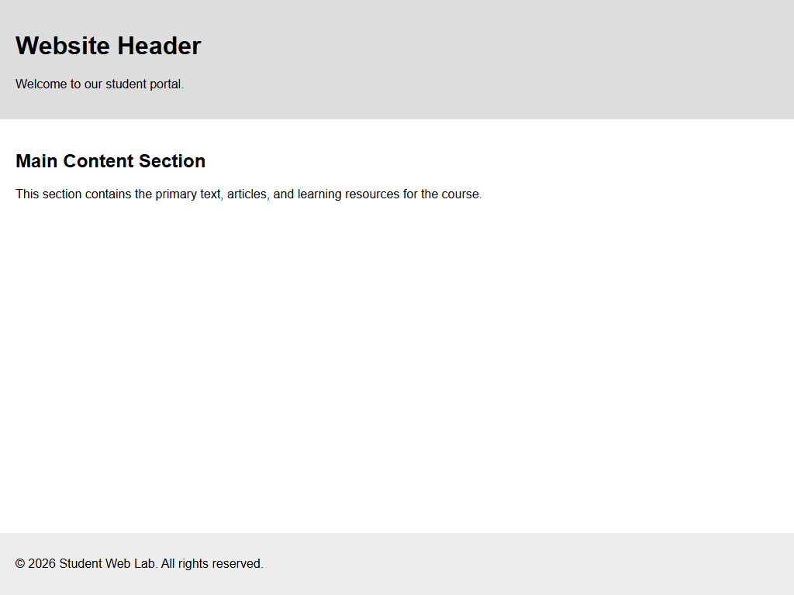

# Assignment 4 - Divs, Attributes and a Small Fix

## 1. Aim
Group parts of a page with div elements, add a data attribute, and fix the errors in a broken page.

## 2. Theoretical Background
- The div Element: A generic block container used to structure pages logically (header, main, footer).
- Attributes: Global attributes like id provide unique identifiers, while class groups elements. Custom data-* attributes store extra page data.
- Debugging HTML: Unclosed tags like missing </h1> or mismatched <p> break standard document rendering and must be corrected.

## 3. Tasks Breakdown
- Task 1 (layout.html): Three div blocks with classes header, main, and footer.
- Task 2 (attributes.html): Div with id profile and paragraph containing data-topic="hobbies".
- Task 3 (attendance-fixed.html): Fixed broken HTML by properly closing the <h1> heading and closing paragraph tags.

## 4. Code Listings

layout.html:
```html
<!DOCTYPE html>
<html lang="en">
<head>
    <meta charset="UTF-8">
    <title>Page Layout with Divs</title>
    <link rel="stylesheet" href="style.css">
</head>
<body>
    <div class="header">
        <h1>Website Header</h1>
        <p>Welcome to our student portal.</p>
    </div>

    <div class="main">
        <h2>Main Content Section</h2>
        <p>This section contains the primary text, articles, and learning resources for the course.</p>
    </div>

    <div class="footer">
        <p>&copy; 2026 Student Web Lab. All rights reserved.</p>
    </div>
</body>
</html>
```

attributes.html:
```html
<!DOCTYPE html>
<html lang="en">
<head>
    <meta charset="UTF-8">
    <title>Custom Data Attributes</title>
    <link rel="stylesheet" href="style.css">
</head>
<body>
    <h1>Student Profile</h1>
    <div id="profile">
        <p data-topic="hobbies">My hobbies include competitive coding, web design, and open-source contribution.</p>
    </div>
</body>
</html>
```

attendance-fixed.html:
```html
<!DOCTYPE html>
<html>
<head>
    <title>Attendance</title>
</head>
<body>
    <h1>Attendance Report</h1>
    <p>Asha: 92%</p>
    <p>Rohan: 85%</p>
</body>
</html>
```

style.css:
```css
body {
    font-family: Arial, sans-serif;
    margin: 0;
    display: flex;
    flex-direction: column;
    min-height: 100vh;
}

.header {
    background-color: #ddd;
    padding: 20px;
}

.main {
    flex: 1;
    padding: 20px;
}

.footer {
    background-color: #eee;
    padding: 15px 20px;
}
```

## 5. Output Verification
Browser output for the layout task:



## 6. Conclusion
The division of document layouts with header, main, and footer divs was implemented, custom data-* attributes were added, and syntax bugs were identified and fixed.
