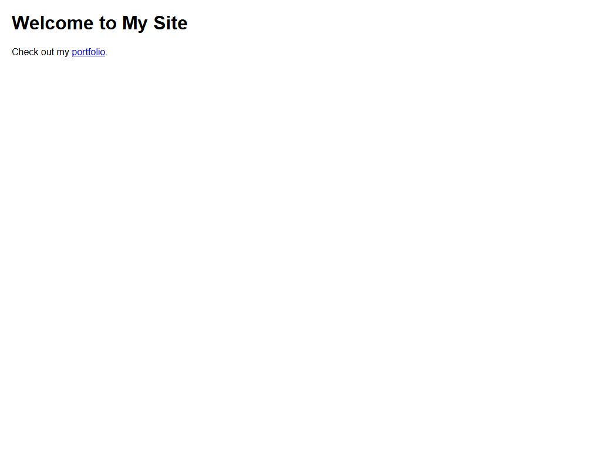

# Assignment 5 - Links and Images

## 1. Aim
Link two pages together and add a picture with alt text.

## 2. Theoretical Background
- Hyperlinks (<a>): The anchor element facilitates navigation between pages using the href attribute.
- Relative URLs: Target filenames within the local folder (e.g., portfolio.html and home.html).
- Images (): Embeds images on a webpage using src, width, height, and alt text for accessibility.

## 3. Tasks Breakdown
- Task 1 (home.html): Heading "Welcome to My Site" and paragraph with a link to portfolio.html.
- Task 2 (portfolio.html): Heading and a return link to home.html.
- Task 3 (portfolio-image.html): Image from images folder with width="200" and height="200" and alt text.

## 4. Code Listings

home.html:
```html
<!DOCTYPE html>
<html lang="en">
<head>
    <meta charset="UTF-8">
    <title>Welcome to My Site</title>
    <link rel="stylesheet" href="style.css">
</head>
<body>
    <h1>Welcome to My Site</h1>
    <p>Check out my <a href="portfolio.html">portfolio</a>.</p>
</body>
</html>
```

portfolio.html:
```html
<!DOCTYPE html>
<html lang="en">
<head>
    <meta charset="UTF-8">
    <title>Portfolio</title>
    <link rel="stylesheet" href="style.css">
</head>
<body>
    <h1>Portfolio</h1>
    <p><a href="home.html">Back to Home</a></p>
</body>
</html>
```

portfolio-image.html:
```html
<!DOCTYPE html>
<html lang="en">
<head>
    <meta charset="UTF-8">
    <title>Portfolio Image</title>
    <link rel="stylesheet" href="style.css">
</head>
<body>
    <h1>Student Portfolio Profile</h1>
    
    <p><a href="home.html">Back to Home</a></p>
</body>
</html>
```

style.css:
```css
body {
    font-family: Arial, sans-serif;
    margin: 20px;
    line-height: 1.6;
    color: #333;
}

h1 {
    color: #222;
}

a {
    color: #0066cc;
    text-decoration: underline;
}

img {
    border: 1px solid #ccc;
    display: block;
    margin-top: 10px;
    margin-bottom: 10px;
}
```

## 5. Output Verification
Verified page rendering with heading and 200x200 photograph:



## 6. Conclusion
Relative hyperlinking between local pages was successfully established, and an accessible image with explicit dimensional constraints (200x200px) and alternate description was embedded.
