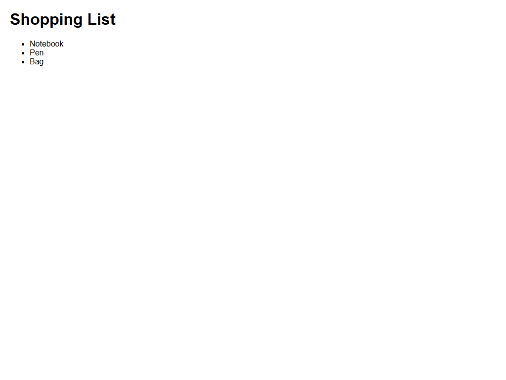

# Assignment 6 - Types of HTML Lists

## 1. Aim
Make a bulleted list, a numbered list with a nested list, and a description list.

## 2. Theoretical Background
- Unordered Lists (<ul>): Bulleted lists for items where sequence does not matter.
- Ordered Lists (<ol>): Numbered lists for sequential steps or ranked items. Nested <ol> creates sub-levels.
- Description Lists (<dl>): Pairs of terms (<dt>) and their descriptions (<dd>).

## 3. Tasks Breakdown
- Task 1 (shopping-list.html): Unordered list of three items (Notebook, Pen, Bag).
- Task 2 (canteen-menu.html): Ordered list with nested sub-items (Cheese and Vegetable under Sandwich).
- Task 3 (faq.html): Description list for two library questions and answers.

## 4. Code Listings

shopping-list.html:
```html
<!DOCTYPE html>
<html lang="en">
<head>
    <meta charset="UTF-8">
    <title>Shopping List</title>
    <link rel="stylesheet" href="style.css">
</head>
<body>
    <h1>Shopping List</h1>
    <ul>
        <li>Notebook</li>
        <li>Pen</li>
        <li>Bag</li>
    </ul>
</body>
</html>
```

canteen-menu.html:
```html
<!DOCTYPE html>
<html lang="en">
<head>
    <meta charset="UTF-8">
    <title>Canteen Menu</title>
    <link rel="stylesheet" href="style.css">
</head>
<body>
    <h1>Canteen Menu</h1>
    <ol>
        <li>Samosa</li>
        <li>Sandwich
            <ol>
                <li>Cheese</li>
                <li>Vegetable</li>
            </ol>
        </li>
    </ol>
</body>
</html>
```

faq.html:
```html
<!DOCTYPE html>
<html lang="en">
<head>
    <meta charset="UTF-8">
    <title>Library FAQ</title>
    <link rel="stylesheet" href="style.css">
</head>
<body>
    <h1>Frequently Asked Questions</h1>
    <dl>
        <dt>How many books can I borrow?</dt>
        <dd>Students can issue up to 4 books simultaneously for a duration of 14 days.</dd>
        <dt>Is the library open on Sunday?</dt>
        <dd>The library remains closed on Sundays and university-notified holidays.</dd>
    </dl>
</body>
</html>
```

style.css:
```css
body {
    font-family: Arial, sans-serif;
    margin: 20px;
    line-height: 1.6;
    color: #333;
}

h1 {
    color: #222;
}

ul, ol {
    margin-bottom: 15px;
}

dt {
    font-weight: bold;
    margin-top: 15px;
    color: #222;
}

dd {
    margin-left: 20px;
    margin-bottom: 10px;
    color: #444;
}
```

## 5. Output Verification
Browser output for canteen menu with nested list:



## 6. Conclusion
Unordered, ordered, nested, and description lists were created and rendered correctly in the browser.
