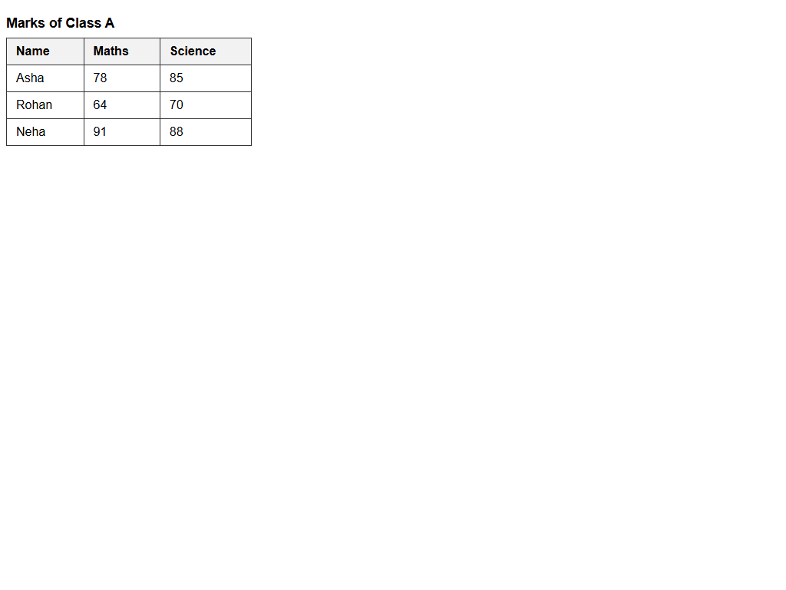

# Assignment 9 - Tables with Headers and Footers

## 1. Aim
Build a table with a caption, a header, rows and a footer, and add scope attributes.

## 2. Theoretical Background
- table Element: Top-level wrapper for tabular data display.
- caption Element: Provides an accessible, visible title for the data table.
- thead, tbody, tfoot: Semantic structural partitions separating column headers, body records, and calculated summary footers.
- scope Attribute: Adds screen reader contextual cues (scope="col" for column headers, scope="row" for row headers).

## 3. Tasks Breakdown
- Task 1 (marks.html): Table with caption "Marks of Class A", header row (Name, Maths, Science), and three rows (Asha 78 85, Rohan 64 70, Neha 91 88).
- Task 2 (marks-average.html): Same caption and header, Asha and Rohan rows (excluding Neha), and tfoot row "Class average" with averages 71 and 77.5.
- Task 3 (marks-accessible.html): Same caption, header, and Asha and Rohan rows without footer; scope="col" on header cells and scope="row" on student name cells.

## 4. Code Listings

marks.html:
```html
<!DOCTYPE html>
<html lang="en">
<head>
    <meta charset="UTF-8">
    <title>Marks of Class A</title>
</head>
<body>
    <table>
        <caption>Marks of Class A</caption>
        <thead>
            <tr>
                <th>Name</th>
                <th>Maths</th>
                <th>Science</th>
            </tr>
        </thead>
        <tbody>
            <tr>
                <td>Asha</td>
                <td>78</td>
                <td>85</td>
            </tr>
            <tr>
                <td>Rohan</td>
                <td>64</td>
                <td>70</td>
            </tr>
            <tr>
                <td>Neha</td>
                <td>91</td>
                <td>88</td>
            </tr>
        </tbody>
    </table>
</body>
</html>
```

marks-average.html:
```html
<!DOCTYPE html>
<html lang="en">
<head>
    <meta charset="UTF-8">
    <title>Marks with Average</title>
</head>
<body>
    <table>
        <caption>Marks of Class A</caption>
        <thead>
            <tr>
                <th>Name</th>
                <th>Maths</th>
                <th>Science</th>
            </tr>
        </thead>
        <tbody>
            <tr>
                <td>Asha</td>
                <td>78</td>
                <td>85</td>
            </tr>
            <tr>
                <td>Rohan</td>
                <td>64</td>
                <td>70</td>
            </tr>
        </tbody>
        <tfoot>
            <tr>
                <td>Class average</td>
                <td>71</td>
                <td>77.5</td>
            </tr>
        </tfoot>
    </table>
</body>
</html>
```

marks-accessible.html:
```html
<!DOCTYPE html>
<html lang="en">
<head>
    <meta charset="UTF-8">
    <title>Accessible Marks Table</title>
</head>
<body>
    <table>
        <caption>Marks of Class A</caption>
        <thead>
            <tr>
                <th scope="col">Name</th>
                <th scope="col">Maths</th>
                <th scope="col">Science</th>
            </tr>
        </thead>
        <tbody>
            <tr>
                <td scope="row">Asha</td>
                <td>78</td>
                <td>85</td>
            </tr>
            <tr>
                <td scope="row">Rohan</td>
                <td>64</td>
                <td>70</td>
            </tr>
        </tbody>
    </table>
</body>
</html>
```

## 5. Output Verification
The table rendered in the browser matches all curriculum requirements:



## 6. Conclusion
The practical demonstrated the creation of structured HTML tables with caption, thead, tbody, and tfoot elements, followed by accessibility enhancements via col and row scope attributes.
